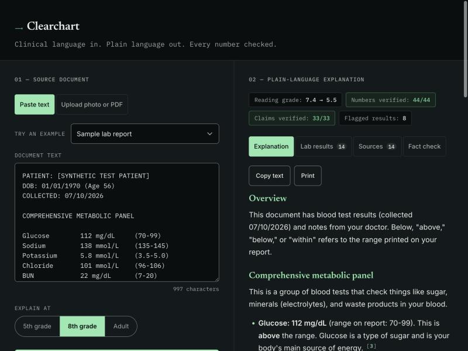

# Clearchart — Plain-Language Medical Document Translator

Paste, upload, or photograph a clinical document (discharge summary, lab
result, radiology report) and get a plain-language explanation. Abnormal lab
values are flagged deterministically in code, general explanations are
grounded in cited MedlinePlus pages, and every number and claim is checked
against the source before it's shown to you.

**This is an educational tool, not medical advice.** Only use synthetic or
de-identified documents with it — never real patient data.



## Why this exists

Roughly a third of US adults struggle to understand their own clinical
documents. This project explores whether an LLM can close that gap safely —
"safely" meaning the model is only ever trusted with *language*, never with
*facts or judgment*. Facts (is this lab value high or low?) are computed in
plain code. Judgment (what does that mean?) is grounded in cited sources.
The model explains; it doesn't decide.

## How it works

```
photo / PDF / paste
   │
   ├─▶ text extraction (PDF text layer → Tesseract → Claude vision);
   │   the user checks the extracted text before anything is translated
   ▼
deterministic lab parsing + flagging            backend/flagging.py   (no AI)
   │  value, unit, printed range → HIGH / LOW / NORMAL
   ▼
MedlinePlus retrieval                           backend/medlineplus.py (no AI)
   │  abnormal tests → MedlinePlus lab-test pages
   │  conditions in the text → MedlinePlus health topics (synonym match + BM25)
   │  medicines with doses → RxNorm → MedlinePlus drug pages
   ▼
Claude translation                              backend/prompts.py, llm.py
   │  lab flags injected as ground truth, references numbered for citation,
   │  reading level as instruction, structured JSON output
   ▼
faithfulness check                              backend/faithfulness.py
   │  1. every number must appear in the source (regex diff, no AI)
   │  2. LLM judge: patient claims vs. the source, general claims vs. references
   ▼
explanation with [n] citations + lab table + sources + fact-check report
```

Design decisions worth calling out:

- **Facts live in code.** The parser decides high/low from the range printed
  on the report. When a report prints no range, the app only falls back to a
  typical adult range for tests whose range doesn't depend on sex, age, or
  therapy (so no fallback for hemoglobin, creatinine, INR, PSA…), and labels
  it as such everywhere.
- **Retrieval is lexical, not embeddings.** Medical terms are precise
  keywords, MedlinePlus publishes synonyms for every topic ("hyperkalemia" →
  Potassium), and BM25 needs no extra API key, runs offline, and is
  deterministic. The whole index is a 1–2 MB JSON file built from NLM's
  official XML.
- **Two-layer verification.** The numeric check is exact and free; the LLM
  judge catches subtler problems (a claim about the patient the document
  never made, or general information presented as a finding).
- **Human in the loop for OCR.** Photo/PDF text is shown to the user to fix
  before translation, because no checker can catch a value the OCR misread.

## Setup

Requires Python 3.11+ (developed on 3.13).

```bash
python -m venv .venv && source .venv/bin/activate
pip install -r backend/requirements.txt
cp backend/.env.example backend/.env   # add your ANTHROPIC_API_KEY
```

Optional: install Tesseract for free local OCR of photos (otherwise Claude
vision reads them):
- macOS: `brew install tesseract`
- Ubuntu/Debian: `sudo apt install tesseract-ocr`

Run it:

```bash
uvicorn main:app --reload --app-dir backend
```

Then open http://localhost:8000 — the frontend is served directly by the
backend, no separate build step needed. Use "Try an example" to load one of
the synthetic documents in `samples/`.

## Tests

```bash
pip install -r requirements-dev.txt
pytest
```

The tests run offline: the Claude client and the live RxNorm/MedlinePlus
lookups are replaced with fakes.

## Evaluation

```bash
python eval/run_eval.py            # all samples (~$0.05 per document)
python eval/run_eval.py --limit 3  # quick smoke run
```

Every `.txt` file in `samples/` goes through both the full pipeline and a
naive one-line prompt ("Explain this medical document simply for a
patient."), and both outputs are scored the same way. Results are written to
[`eval/results.md`](eval/results.md) and `eval/results.json`.

### Results (19 synthetic documents, `claude-sonnet-5-5`, 8th-grade level)

| Metric | Full pipeline | Naive prompt |
|---|---|---|
| Numbers that trace back to the document | **100%** | 98% |
| Unsupported claims about the patient (LLM judge) | **1 of 638** checked | 66 of 500 checked |
| Abnormal lab results the explanation mentions | **100%** | 70% |
| "Not medical advice" disclaimer present | **100%** | 47% |
| Reading grade level (source documents: 7.5) | 5.9 | 6.0 |
| Documents with MedlinePlus citations | 18 of 19 | — |

What this shows:

- **The extra machinery buys accuracy and completeness, not readability.**
  Both versions bring a grade-7.5 document down to about grade 6; a modern
  model simplifies well with a one-line prompt. Where the naive prompt falls
  down is trust: it added numbers the document never contained (a "normal"
  ejection fraction of 55–70%, how long a biopsy takes, exercise targets),
  made 66 claims about the patient the document didn't support, and skipped
  almost a third of the abnormal results — the ones a patient most needs
  explained. The full pipeline's single flagged claim was calling the
  referring orthopedic surgeon "your knee doctor".
- **Ground truth in code keeps the model honest.** Injecting the
  deterministic lab flags means every abnormal value gets explained and none
  is re-judged; instructing the model to use only the document's numbers
  holds up across all 19 documents.
- **Citations are nearly universal.** 18 of 19 explanations cite MedlinePlus;
  the one that doesn't is the all-normal annual physical, which has nothing
  abnormal to look up.

Caveats: this is one run over 19 synthetic documents, so treat the numbers as
indicative. The "unsupported claims" judge is also Claude (same model, with
the source, the lab flags and the references in front of it), so it can share
the generator's blind spots; the numeric check has no such issue. Per-document
results, every explanation, and every flagged claim are in
[`eval/results.md`](eval/results.md) and `eval/results.json`, and
`python eval/run_eval.py --rescore` re-scores the saved outputs without
calling the API.

## Project structure

```
backend/
  main.py          FastAPI app: endpoints, rate limiting, error handling
  pipeline.py      the translation pipeline (shared by the API and the eval)
  flagging.py      deterministic lab parsing + flagging
  medlineplus.py   MedlinePlus retrieval (synonyms, BM25, RxNorm drug lookup)
  faithfulness.py  numeric check + LLM judge
  prompts.py       every prompt and JSON schema
  llm.py           the one place that calls the Claude API
  ocr.py           PDF / Tesseract / Claude-vision text extraction
  data/medlineplus_index.json   built by scripts/build_medlineplus_index.py
frontend/          static HTML/CSS/JS, served by the backend
samples/           synthetic documents (the eval set)
eval/run_eval.py   full pipeline vs. naive prompt
scripts/           index builder
tests/             pytest suite
API_CONTRACT.md    the JSON the frontend and backend agree on
```

## Configuration

Set these in `backend/.env` (see `backend/.env.example`):

| Variable | Default | What it does |
|---|---|---|
| `ANTHROPIC_API_KEY` | — | Required for translation |
| `ANTHROPIC_MODEL` | `claude-sonnet-5-5` | Model for translation, judging and OCR |
| `MAX_OUTPUT_TOKENS` | `6000` | Output cap per call (thinking counts toward it) |
| `OCR_ENGINE` | `auto` | `auto`, `tesseract` or `claude` |
| `RATE_LIMIT_PER_HOUR` | `30` | Claude-backed requests per IP per hour (0 = off) |
| `MAX_DOCUMENT_CHARS` | `20000` | Longest document accepted |
| `MAX_UPLOAD_MB` | `10` | Largest upload accepted |
| `MAX_CONCURRENT_JOBS` | `8` | Documents processed at once; extra requests get a "busy" reply |
| `ANTHROPIC_TIMEOUT_SECONDS` | `150` | Per-call timeout for the Claude API |
| `OCR_MAX_TOKENS` | `16000` | Output cap for photo/PDF transcription |
| `ALLOWED_ORIGINS` | — | Only if the frontend is hosted on another origin |
| `CLIENT_IP_HEADER` | — | Header with the visitor's real IP behind a hosting proxy (Render: `CF-Connecting-IP`) |

To refresh the MedlinePlus data: `python scripts/build_medlineplus_index.py`.

## Deploying a public demo

`render.yaml` sets the app up on [Render](https://render.com)'s free plan in
one step. Everything below happens in your browser; about 15 minutes.

**1. Make a capped API key** (so a public demo can't run up your bill)
1. In the [Claude Console](https://platform.claude.com/settings/workspaces),
   create a workspace (e.g. `clearchart-demo`), select it, and set a monthly
   **Spend limit** (e.g. $10). The Default workspace can't have a limit,
   which is why the demo gets its own.
2. On the [API keys](https://platform.claude.com/settings/keys) page, create a
   key scoped to that workspace. Copy it.

**2. Get the code onto `main`:** merge the pull request on GitHub.

**3. Create the service on Render**
1. Sign up at [dashboard.render.com](https://dashboard.render.com/register)
   (the free Hobby workspace is fine; Render may ask for a card to verify
   you, even on the free plan).
2. **New → Blueprint**, connect GitHub, and pick
   `OkayCombo66/Med_Translation_WebApp`. Render finds `render.yaml`.
3. When it asks for `ANTHROPIC_API_KEY`, paste the key from step 1.
   Click **Deploy Blueprint**.
4. The first build takes a few minutes. When it's live, open
   `https://<your-service>.onrender.com/api/health` and check it says
   `"api_key_configured": true`.

**4. Check the per-visitor limit works:** in the service's **Environment**
tab, temporarily set `RATE_LIMIT_PER_HOUR` to `2` and redeploy. Translate
three times from your laptop (the third should say you hit the limit), then
try once from your phone on cellular data — it should still work. That proves
each visitor gets their own allowance. Set it back to `30`.

Things to know about the free plan: it sleeps after 15 minutes without
visitors and takes about a minute to wake (an always-on instance is $7/month),
the in-memory rate limit resets whenever it restarts, and it allows 750
running hours a month. To change the key later: service → **Environment** →
edit `ANTHROPIC_API_KEY` → **Save and deploy**.

Other hosts work too — the `Dockerfile` runs on any container platform. Set
`CLIENT_IP_HEADER` to whatever header your platform uses for the visitor's
real IP. Never set uvicorn's `FORWARDED_ALLOW_IPS` to `*`: visitors could then
fake their IP with an `X-Forwarded-For` header and skip the limit.

## Limitations

- The lab parser handles common table layouts (columns, pipes, H/L flags,
  one-sided ranges) but will miss unusual formats; missed lines are still
  explained as prose, they just don't get a deterministic flag.
- Reference ranges vary by lab; the app always prefers the range printed on
  the report.
- The LLM judge is itself a model and can miss things or over-flag; its job
  is to surface claims for a human to double-check.
- English only.

## Data sources

Health topic, lab test and drug information comes from
[MedlinePlus](https://medlineplus.gov), U.S. National Library of Medicine,
via its health topic XML files and the MedlinePlus Connect and RxNorm web
services. MedlinePlus content is linked and quoted briefly with attribution;
drug information is fetched live and never stored in this repository. Note
that medicine names from a translated document are sent to these public NLM
services to look them up; the demo's privacy notice says so.

## License

MIT — see [LICENSE](LICENSE).
